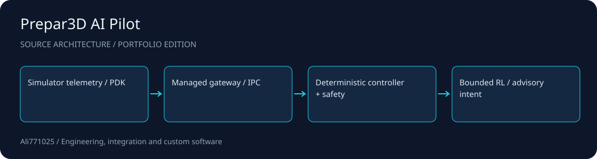

# Prepar3D AI Pilot

**A simulator research platform combining deterministic control, a bounded PDK bridge and ML tooling.**

C# / .NET · C++ PDK · Python · Reinforcement learning

[راهنمای فارسی](docs/README.fa.md) · [Architecture](docs/ARCHITECTURE.md) · [Discuss a project](https://github.com/Ali771025)

## What this demonstrates

- Managed gateway and native PDK bridge with structured IPC contracts.
- Simulator-neutral state/control boundaries and deterministic safety supervision.
- Python behavior-cloning, residual RL and advanced policy research source.

## Source map

| Path | Responsibility |
| --- | --- |
| `src/native/` | Native PDK bridge |
| `src/gateway/` | Managed gateway |
| `src/P3DAIPilot.Core/` | Deterministic control core |
| `rl/` | Residual RL tooling |
| `advanced/` | Policy research |

## Setup and integration

Windows x64, Prepar3D v4, its matching licensed SDK, the .NET Framework 4.7.2 developer toolchain and a compatible C++ compiler are required for simulator components. Restore NuGet and Python dependencies from project manifests. Obtain SimConnect/FSUIPC and model assets separately under their own terms; binaries and trained weights are excluded. The solution retains original test-project references, but test sources are omitted from this compact edition: select the production gateway/host projects for integration and restore any development-only projects separately. Review deployment/pdk and source project paths for the installed SDK.

## Scope and evidence

Simulator research only. Preserve ControlsEnabled=0 and OrientationVerified=0; flight_validated=false and live_policy_eligible=false remain the authority boundary wherever defined. LLM output is bounded intent, never raw actuator authority. No live P3D, F-22 flight, policy, hardware or real-aircraft acceptance is claimed. Older v2/v3 release trees are represented by this later source line; genuinely unique legacy modules are documented separately in the local publication audit.

This public portfolio edition contains selected source and integration manifests. Contracts, private data, customer materials, original Git history, dependency trees and large assets are excluded. No tests, builds or application runs were performed for this publication; no previous result is presented as a current validation.

## Work with me

I am available for projects involving C# / .NET, C++ PDK, Python, Reinforcement learning. For a useful first discussion, share the problem, target environment, expected deliverables and acceptance criteria. I can help scope an implementation, integration or improvement around your constraints.

Contact: [Ali771025 on GitHub](https://github.com/Ali771025). Please share confidential material through an agreed private channel.

## Rights and dependencies

Publication for portfolio review does not grant a new blanket license. Existing file notices and dependency terms continue to apply. Contact the author to agree terms for reuse or a commercial engagement.
