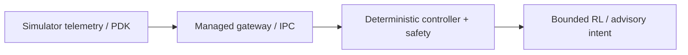

# Prepar3D AI Pilot architecture

The diagram describes the source responsibilities, not a measured production deployment.

| Module | Responsibility |
| --- | --- |
| `src/native/` | Native PDK bridge |
| `src/gateway/` | Managed gateway |
| `src/P3DAIPilot.Core/` | Deterministic control core |
| `rl/` | Residual RL tooling |
| `advanced/` | Policy research |

Simulator research only. Preserve ControlsEnabled=0 and OrientationVerified=0; flight_validated=false and live_policy_eligible=false remain the authority boundary wherever defined. LLM output is bounded intent, never raw actuator authority. No live P3D, F-22 flight, policy, hardware or real-aircraft acceptance is claimed. Older v2/v3 release trees are represented by this later source line; genuinely unique legacy modules are documented separately in the local publication audit.
